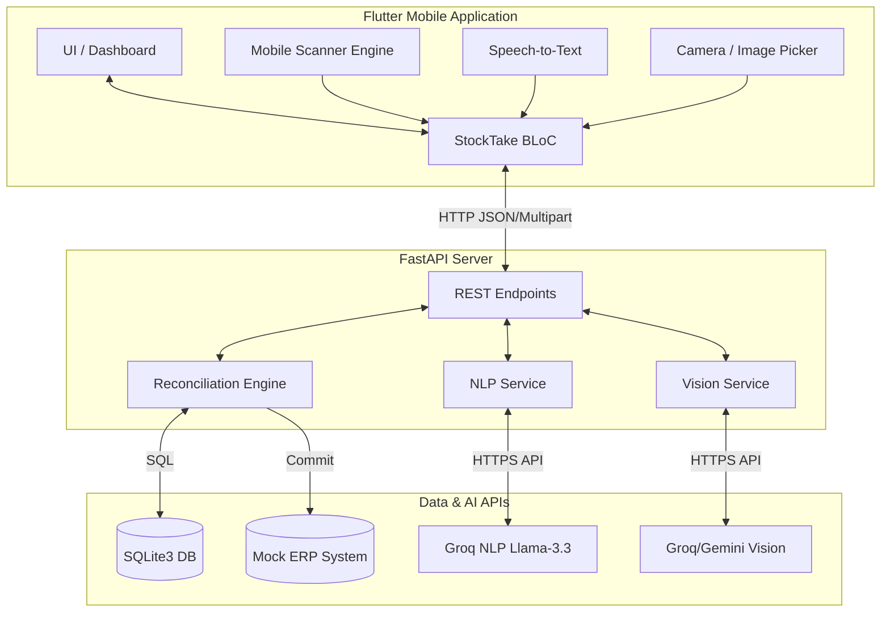

# StockPulse: AI-Powered Multi-Modal Inventory Auditing System

## 1. Project Title & Executive Summary

**StockPulse** is a next-generation warehouse inventory reconciliation system bridging the gap between physical floor counting and digital ERP ledgers. By integrating multi-modal AI capture (Vision, Speech NLP) with traditional Edge Barcode scanning, StockPulse transforms tedious inventory audits into a frictionless, highly accurate, and extremely rapid process. 

**Core Pillars:**
- **Edge Barcode Verification**: Fast, reliable, deterministic local barcode verification.
- **VLM Vision Capture**: Snap a photo of a shelf and utilize advanced Vision-Language Models to automatically identify products and calculate quantities.
- **Speech NLP Counting**: Hands-free natural language voice dictation ("I found fifteen more loose red apples").
- **Deterministic Reconciliation**: Local catalog and logic map physical inventory against system quantities, categorizing discrepancies immediately.
- **Manager AI Copilot**: Ask conversational questions about real-time audit variances before committing to the ERP ledger.

---

## 2. End-to-End System Architecture

### ASCII Architecture Diagram
```text
  [Floor Associate]                  [Store Manager]
         |                                  |
 +--------------------------------------------------+
 |               Flutter Mobile App                 |
 |  [Barcode Scanner] [Voice Mic] [Camera Lens]     |
 |           |             |            |           |
 |     <Local BLoC State & Inventory Caching>       |
 +--------------------------------------------------+
         | (HTTP)          | (Multipart)    | (JSON)
 +--------------------------------------------------+
 |               FastAPI Python Backend             |
 |  +---------------+  +--------------+  +-------+  |
 |  | Stock Ledger  |  | AI NLP Parse |  | VLM   |  |
 |  | & Discrepancy |  | Engine       |  | Core  |  |
 |  +---------------+  +--------------+  +-------+  |
 +--------------------------------------------------+
         | (SQL)           | (API)          | (API)
 [SQLite Database]      [Groq / Llama]  [Groq/Gemini]
```

### Mermaid Flowchart



### Component Responsibilities Table

| Component | Responsibility | Technology |
| :--- | :--- | :--- |
| **Mobile Client** | Responsive UI, state management, role switching (Associate/Manager), multi-modal capture interfaces. | Flutter, BLoC, Freezed |
| **Edge Scanner** | Local device camera hardware abstraction for rapid, highly accurate QR/Barcode scanning. | `mobile_scanner` plugin |
| **Vision/Voice AI** | Bridges raw hardware inputs (Audio/Photos) to cloud inference. Compiles contexts. | `speech_to_text`, `image_picker` |
| **FastAPI Backend** | Handles routing, coordinates AI models, enforces deterministic reconciliation business logic. | Python FastAPI, Uvicorn |
| **Reconciliation Engine** | Compares physical counts against system quantities. Flags shortages/surpluses. | Python, SQLite3 |
| **AI Ledger Engine** | Transcribes voice intents and evaluates visual bounding proxies for SKUs. | Groq (Llama-3), Gemini |

---

## 3. Frozen 10-Item Product Catalog

| SKU | Product Name | Barcode | System Qty | Visual Description |
| :--- | :--- | :--- | :--- | :--- |
| **P001** | Coca Cola 500ml | 5449000000996 | 25 | Red label, cylindrical plastic bottle with black liquid and white script logo |
| **P002** | Pepsi 500ml | 012000000133 | 20 | Blue bottle/can with circular red, white, and blue globe logo |
| **P003** | Lays Classic Chips | 028400017145 | 15 | Bright yellow bag with circular red and yellow Lay's sun logo |
| **P004** | KitKat 4-Finger | 5000159461122 | 30 | Red rectangular candy bar pack with white oval KitKat logo |
| **P005** | Tomato Sauce Bottle | `null` | 12 | Glass or squeeze bottle with red condiment sauce and green cap |
| **P006** | Digestive Biscuits | `null` | 18 | Cylindrical roll pack of wheat biscuits in brown/tan packaging |
| **P007** | Mineral Water 1L | 8901764012235 | 40 | Clear transparent plastic water bottle with blue label and blue cap |
| **P008** | Orange Juice Carton | `null` | 10 | Rectangular paper carton with pictures of oranges and screw-on cap |
| **P009** | Dairy Milk Chocolate | 7622210286153 | 22 | Deep purple wrapper with Cadbury gold cursive lettering |
| **P010** | Loose Red Apples | `null` | 16 | Fresh round red fruit/produce without packaging |

---

## 4. Technology Stack

### Frontend
- **Framework:** Flutter 3.x
- **State Management:** `flutter_bloc`
- **Routing:** `go_router`
- **Data Models:** `freezed`, `json_serializable`
- **Networking:** `dio`
- **Hardware Integration:** `mobile_scanner`, `speech_to_text`, `image_picker`

### Backend
- **Framework:** FastAPI, Uvicorn
- **Data Validation:** Pydantic v2
- **Database:** SQLite3 (Local Ledger)

### AI Engine
- **Vision Models:** Groq Vision (`llama-3.2-11b-vision-preview`), `qwen/qwen3.8-27b`
- **NLP/Voice Parsing Models:** Groq NLP (`llama-3.3-70b-versatile`)
- **Fallback Models:** Google Gemini 3.5 Flash-Lite

---

## 5. Step-by-Step Setup & Run Instructions

### Prerequisites
- **Flutter SDK:** 3.19.0 or higher.
- **Python:** 3.10+
- **Android ADB Tools:** Available in system PATH for physical device connection bridging.
- **API Keys:** Groq API Key and Google Gemini API Key.

### 1. Backend Setup (FastAPI)
Navigate to the backend directory:
```bash
cd backend
```
Create a virtual environment and activate it:
```bash
python3 -m venv venv
source venv/bin/activate  # macOS/Linux
# .\venv\Scripts\activate # Windows
```
Install dependencies:
```bash
pip install -r requirements.txt
```
Configure environment variables by copying the provided example file:
```bash
cp .env.example .env
```
Then open `.env` and fill in your actual API keys:
```env
GROQ_API_KEY=your_actual_groq_api_key_here
GEMINI_API_KEY=your_actual_gemini_api_key_here
```
Run the backend server:
```bash
uvicorn app.main:app --host 0.0.0.0 --port 8000 --reload
```

### 2. Mobile Setup (Flutter)
Open a new terminal tab and navigate to the project root. Connect your Android device via USB and ensure USB Debugging is enabled.

Reverse the TCP port so your physical device can securely tunnel to your machine's `localhost`:
```bash
adb reverse tcp:8000 tcp:8000
```
Fetch Flutter dependencies:
```bash
flutter pub get
```
Run the application:
```bash
flutter run
```

---

## 6. Presentation Demo Script

**Scenario Context:** An enterprise retail environment migrating from clipboard inventory taking to an AI-assisted ecosystem. 

1. **Floor Associate Mode:** Open the app and observe the seamless UI. Leave the role toggle on "Floor Associate".
2. **Session Initialization:** Tap `Start Today's Stock Take`.
3. **Traditional Barcode Edge Scan:** 
   - Tap `Scan Barcode` on the dashboard.
   - Scan a Coca-Cola bottle (P001). 
   - Observe the immediate deterministic match, adding exactly +1 to the physical tally. 
4. **VLM AI Vision Snap:** 
   - Tap the camera icon from the count view (or `AI Vision Capture` from the dashboard).
   - Take a picture of 12 Loose Red Apples (P010).
   - Let the Vision model evaluate the image and return `Qty: 12`.
   - Observe the quantities merge elegantly: 12 physical vs 16 system (System reports -4 Shortage).
5. **Hands-Free AI Voice Count:**
   - Tap the Mic icon.
   - Say: *"I found fifteen bags of Lays Classic chips!"*
   - Watch the NLP extraction map the intent perfectly to SKU `P003` with a physical count of 15.
6. **Submit to Audit:** Tap `Submit to Manager for Audit`.
7. **Role Switcher (Manager Context):**
   - Toggle the persona switch at the top to "Store Manager".
   - The UI intelligently pivots to the Audit & Reconciliation Hub.
8. **Reconciliation Engine:**
   - Drill into the discrepancies. Note how the LLM perfectly evaluated shortages vs surpluses in real time.
9. **Manager AI Copilot:**
   - Tap `✨ Ask AI Copilot`. 
   - Ask: *"Why are we short on Red Apples?"* 
   - Observe the conversational retrieval augmented generation (RAG) providing contextualized responses against the audit state.
10. **Finalize ERP Commit:** 
    - Tap `Review Discrepancies & Approve` to commit the cycle count, synchronizing the physical stock back into the Master ERP Ledger.

---

## 7. Production Roadmap (Post-POC Scalability)

To scale StockPulse from a robust Proof of Concept to a comprehensive Enterprise deployment, the following architectures will be prioritized:

1. **Edge YOLOv10 Object Detection:**
   - **Goal:** Shift away from API-bound VLMs for basic item counts. Deploy quantized YOLO models directly to the edge (mobile CPU/NPU) utilizing TensorFlow Lite for zero-latency, offline bounding box item mapping.
2. **Contrastive Visual Search (DINOv2 / CLIP + pgvector):**
   - **Goal:** Current matching works with a frozen 10-SKU limit due to LLM context boundaries. Implementing a dedicated vector embedding database (like PostgreSQL with `pgvector`) will allow scanning photos against a dense catalog of 5,000+ enterprise SKUs using visual embeddings (e.g., DINOv2 or OpenAI CLIP) for near-instant multi-modal semantic search.
3. **Bi-Directional Offline Sync Queues:**
   - **Goal:** Build a background worker pool ensuring that physical inventory counts can be performed deep inside dead-zone warehouse freezers. SQLite changes will pool locally via CRDT logic and sync via conflict-resolution ledgers once connectivity is restored.
